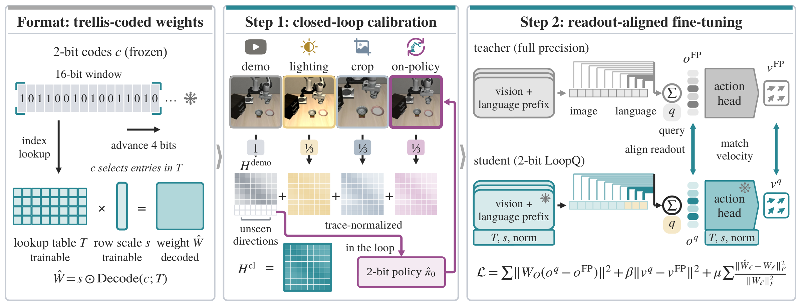
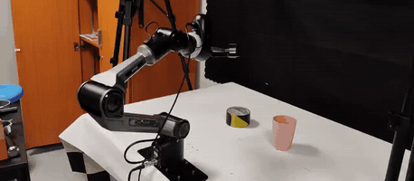
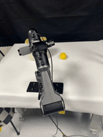
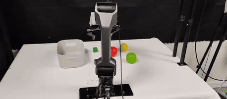
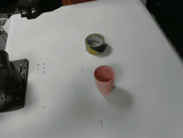
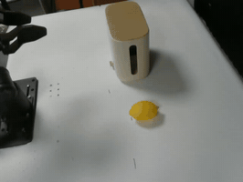
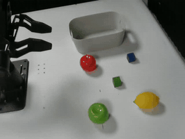

<p align="center">
  <picture>
    <source media="(prefers-color-scheme: dark)" srcset="assets/logo-dark.svg">
    
  </picture>
</p>

<h2 align="center">Quantizing in the Loop</h2>
<p align="center"><b>Drift-Aware Ultra-Low-Bit Vision-Language-Action Models</b></p>

<p align="center">
  <a href="https://arxiv.org/abs/2611.30178"></a>
  <a href="https://huggingface.co/ForeverBlue/LoopQ-pi05-libero-2bit"></a>
  <a href="https://huggingface.co/ForeverBlue/LoopQ-GR00T-N1.7-libero-2bit"></a>
  <a href="results"></a>
</p>

<p align="center">
  <a href="https://arxiv.org/abs/2611.30178">Paper</a> ·
  <a href="#real-robot">Real robot</a> ·
  <a href="#checkpoints">Checkpoints</a> ·
  <a href="#results">Results</a> ·
  <a href="#repository">Repository</a> ·
  <a href="#citation">Citation</a>
</p>

<br>

<p align="center"></p>

A policy acts in closed loop: its outputs decide its next inputs. **LoopQ** quantizes a vision-language-action model with that
loop in view: calibration follows the quantized policy, and fine-tuning follows what the action head reads.

<table align="center">
  <tr>
    <td align="center" width="25%"><h3>60.4 %</h3><sub>GR00T N1.7 on LIBERO-Plus at 2 bits<br>full precision: 61.8 %</sub></td>
    <td align="center" width="25%"><h3>74.9 %</h3><sub>π₀.₅ on LIBERO-Plus at 2 bits<br>full precision: 76.5 %</sub></td>
    <td align="center" width="25%"><h3>80.0 %</h3><sub>π₀.₅ on LIBERO<br>at 1 bit per weight</sub></td>
    <td align="center" width="25%"><h3>4.1×</h3><sub>smaller weights on the robot<br>44 % less GPU memory</sub></td>
  </tr>
</table>

## Real robot

The 2-bit LoopQ π₀.₅ policy on an AgileX Piper arm.

<table align="center">
  <tr>
    <th></th>
    <th align="center">Stack a cup onto a tape roll</th>
    <th align="center">Put a lemon into a lidded bin</th>
    <th align="center">Move objects into a box in clutter</th>
  </tr>
  <tr>
    <td><sub>Third-person<br>view</sub></td>
    <td align="center"><a href="assets/demos/stack_cup_side.mp4"></a></td>
    <td align="center"><a href="assets/demos/lemon_bin_side.mp4"></a></td>
    <td align="center"><a href="assets/demos/apple_box_side.mp4"></a></td>
  </tr>
  <tr>
    <td><sub>Overhead<br>camera</sub></td>
    <td align="center"><a href="assets/demos/stack_cup_top.mp4"></a></td>
    <td align="center"><a href="assets/demos/lemon_bin_top.mp4"></a></td>
    <td align="center"><a href="assets/demos/apple_box_top.mp4"></a></td>
  </tr>
</table>

| π₀.₅ policy | Successes (of 75) | Weights on disk | GPU memory | Action chunk |
|:---|:---:|:---:|:---:|:---:|
| Full precision | 59 | 6.47 GB | 6.65 GB | 81.6 ms |
| **LoopQ** · 2-bit weights, 8-bit activations | 58 | **1.58 GB** | **3.72 GB** | **74.6 ms** |

## Checkpoints

The 2-bit models of the paper, on Hugging Face.

| Model | Checkpoint |
|:---|:---|
| π₀.₅ · LIBERO · 2 bits | 🤗 [ForeverBlue/LoopQ-pi05-libero-2bit](https://huggingface.co/ForeverBlue/LoopQ-pi05-libero-2bit) |
| GR00T N1.7 · LIBERO · 2 bits | 🤗 [ForeverBlue/LoopQ-GR00T-N1.7-libero-2bit](https://huggingface.co/ForeverBlue/LoopQ-GR00T-N1.7-libero-2bit) |

Both are LoopQ checkpoints, calibrated and fine-tuned on LIBERO, and the same checkpoints run on LIBERO-Plus. They load with the
stock openpi and Isaac-GR00T loaders.

<details>
<summary>Load π₀.₅ with openpi</summary>

```python
from huggingface_hub import snapshot_download
from openpi.policies import policy_config
from openpi.training import config

checkpoint = snapshot_download("ForeverBlue/LoopQ-pi05-libero-2bit")
policy = policy_config.create_trained_policy(config.get_config("pi05_libero"), checkpoint)
actions = policy.infer(observation)["actions"]
```
</details>

<details>
<summary>Load GR00T N1.7 with Isaac-GR00T</summary>

```python
from huggingface_hub import snapshot_download
from gr00t.policy.gr00t_policy import Gr00tPolicy

root = snapshot_download("ForeverBlue/LoopQ-GR00T-N1.7-libero-2bit", allow_patterns=["libero_goal/*"])
policy = Gr00tPolicy(embodiment_tag="LIBERO_PANDA", model_path=f"{root}/libero_goal", device="cuda")
action, _ = policy.get_action(observation)
```
</details>

## Results

LIBERO-Plus success (%) with every linear layer at 2 bits, on 1,000 paired instances per model: 500 with changed camera
viewpoints and 500 with changed robot initial states.

<table align="center">
  <tr>
    <th rowspan="2" align="left">Method</th>
    <th colspan="3" align="center">GR00T N1.7</th>
    <th colspan="3" align="center">π₀.₅</th>
  </tr>
  <tr>
    <th align="center">All</th><th align="center">Camera</th><th align="center">Init. state</th>
    <th align="center">All</th><th align="center">Camera</th><th align="center">Init. state</th>
  </tr>
  <tr><td>Full precision</td><td align="center">61.8</td><td align="center">65.2</td><td align="center">58.4</td><td align="center">76.5</td><td align="center">74.4</td><td align="center">78.6</td></tr>
  <tr><td>AQLM</td><td align="center">40.1</td><td align="center">40.2</td><td align="center">40.0</td><td align="center">63.9</td><td align="center">60.8</td><td align="center">67.0</td></tr>
  <tr><td>VPTQ</td><td align="center">49.5</td><td align="center">51.6</td><td align="center">47.4</td><td align="center">68.5</td><td align="center">65.8</td><td align="center">71.2</td></tr>
  <tr><td>QuIP#</td><td align="center">53.1</td><td align="center">54.4</td><td align="center">51.8</td><td align="center">66.2</td><td align="center">64.6</td><td align="center">67.8</td></tr>
  <tr><td>QTIP</td><td align="center">55.9</td><td align="center">54.4</td><td align="center">57.4</td><td align="center">72.6</td><td align="center">71.0</td><td align="center">74.2</td></tr>
  <tr><td>Closed-loop calibration only</td><td align="center">57.5</td><td align="center">57.8</td><td align="center">57.2</td><td align="center">73.4</td><td align="center">70.2</td><td align="center">76.6</td></tr>
  <tr><td><b>LoopQ</b></td><td align="center"><b>60.4</b></td><td align="center"><b>62.2</b></td><td align="center"><b>58.6</b></td><td align="center"><b>74.9</b></td><td align="center"><b>72.8</b></td><td align="center"><b>77.0</b></td></tr>
</table>

At 1 bit per weight, π₀.₅ with LoopQ completes 80.0 % of LIBERO; the best baseline reaches 65.6 %.

## Repository

| Path | Content |
|:---|:---|
| [`results/`](results) | Per-episode outcomes on LIBERO-Plus and LIBERO, at 2 bits and 1 bit |
| [`baselines/`](baselines) | Evaluation protocol and baseline harness for π₀.₅ and GR00T N1.7 |
| [`deploy/tcq_kernels/`](deploy/tcq_kernels) | CUDA kernels for the 2-bit format with 8-bit activations |
| [`assets/`](assets) | Logo, method figure and real-robot clips |

Evaluate a checkpoint on the 1,000 LIBERO-Plus instances and pair it with any released row:

```bash
cd baselines
python serve.py --checkpoint ./my_checkpoint --port 8105 &
python eval_libero_plus.py --port 8105 --units data/plus_units_selection_1000.json --out ./my_checkpoint/plus_1000.jsonl
python paired_stats.py plus --candidate ./my_checkpoint/plus_1000.jsonl --reference ../results/libero_plus/pi05/full_precision.jsonl
```

## Citation

If you use LoopQ, its checkpoints or its results, please cite our paper:

```bibtex
@article{chen2026loopq,
  title   = {Quantizing in the Loop: Drift-Aware Ultra-Low-Bit Vision-Language-Action Models},
  author  = {Chen, Yanlong and Chamadol, Thongthornpatch and Guo, Yichen and Gao, Yunfei and Liu, Mohan and Wang, Addison Lin and Li, Yawei},
  journal = {arXiv preprint arXiv:2611.30178},
  year    = {2026}
}
```
